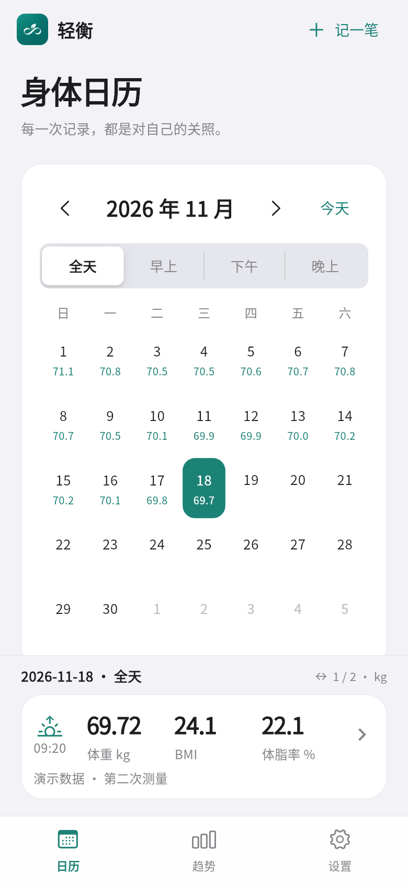
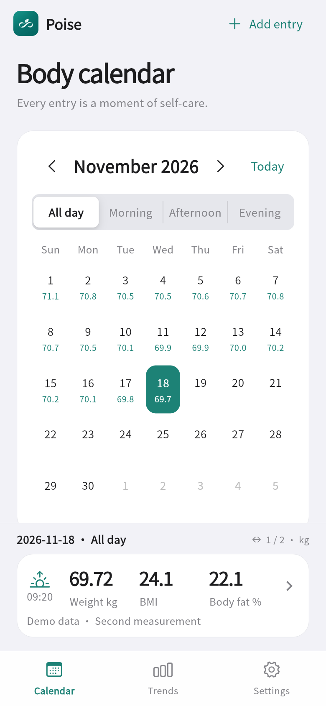
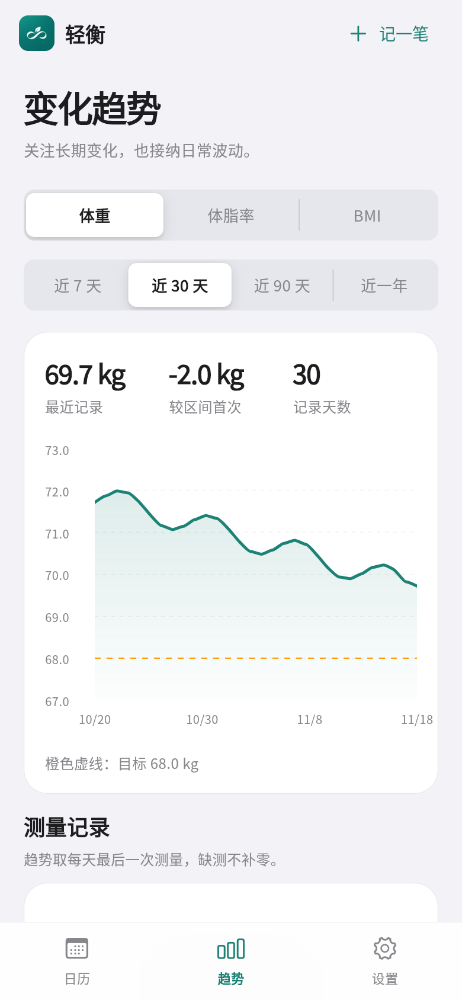
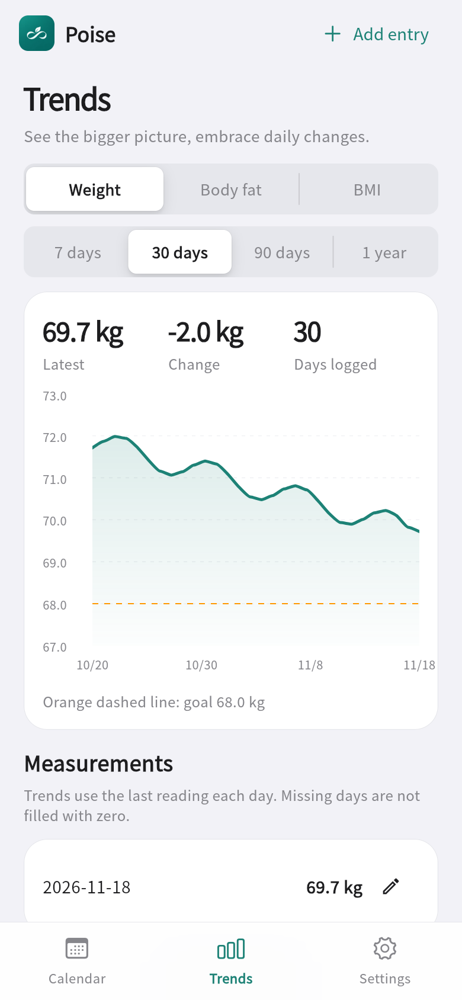
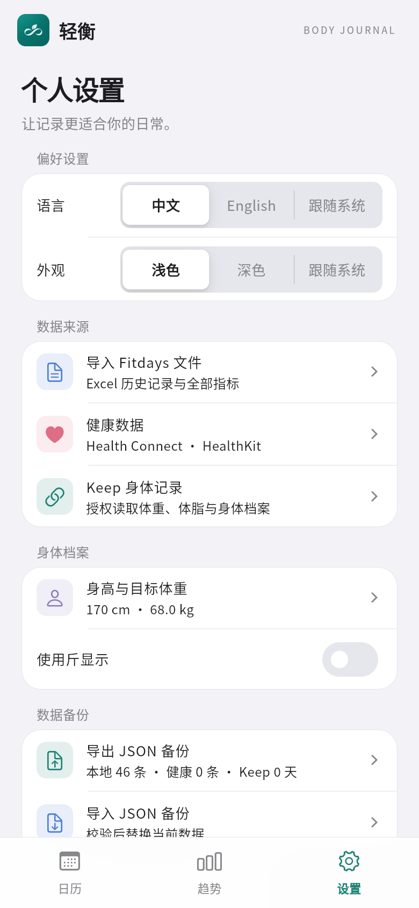
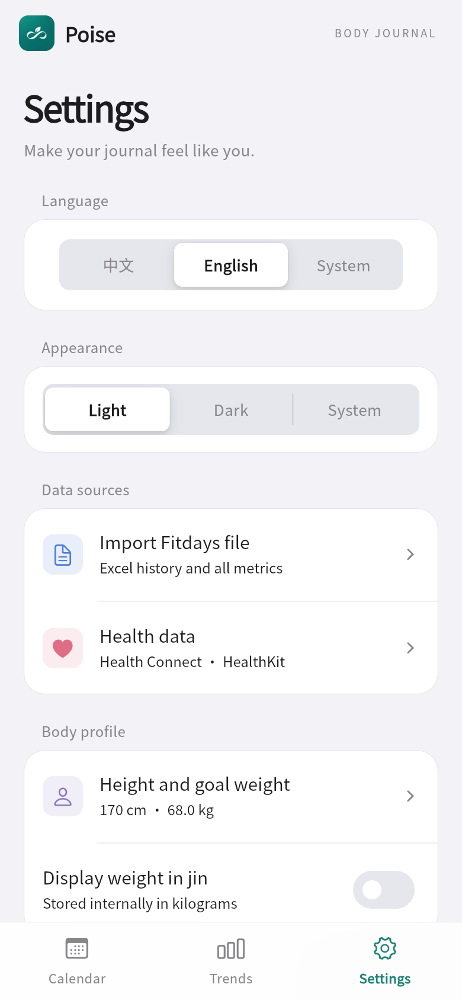

# Poise · 轻衡

[软件主页 / Website](https://poise.onepeak.cn/) · [Download Android APK / 下载安卓版](https://github.com/FinnWang-CN/Poise/releases/latest)

Poise means balance and composure. A local-first Flutter body journal for Android, iOS and Web, with English and Chinese UI. Switch under **Settings → Language → 中文 / English / System**. Existing installations keep Chinese until you change the setting.

Once connected, Health Connect / HealthKit sync automatically when opening or returning to the app. Keep is a separate read-only source: authorize once, read daily weight/body-fat values, review, and import. Keep authorization checks for the installed app and opens Keep directly, without a QR image. The entry uses official Keep artwork. Keep login uses device secure storage; no Keep auto-sync in this version. See [Keep connection](docs/KEEP.md).

Track weight, body fat, BMI and imported Fitdays metrics with a calendar and smooth trend charts. Read-only Health Connect / HealthKit integration, local .xlsx import, JSON backup, light/dark/system appearance, and stable-height daily record cards are included.

Built with Flutter 3.29.3 / Dart 3.7.2. Run `flutter pub get`, then `flutter run`. Use `flutter analyze` and `flutter test` for validation. Before building an Android release, create your own local test keystore using [the setup instructions](docs/HEALTH.md); signing keys are excluded from this repository. Linux cannot build an iOS IPA; use macOS with Xcode. Health integration still requires real-device verification.

In 0.8.4, Settings ends with “Support the author”, showing the original WeChat appreciation code with screenshot instructions. Support is optional.

In 0.8.3, entry, profile and backup forms use compact keyboard-aware bottom sheets. Labels stay outside input borders, fields scroll above the keyboard, and Cancel / Save are right-aligned text actions. Large text no longer wraps the bottom navigation. The website supports a persistent light / dark theme.

Keep results open in a bottom sheet with a fixed confirmation button. Close without saving, reopen the preview, or confirm to save and see a success dialog. Keep authorization currently requires manually returning to Poise after confirming in Keep.

The compact interface keeps more content on screen. Language and appearance share one preferences card; detailed import rules and health-data explanations expand on demand.

## Screenshots / 界面预览

Screenshots use fictional demo data. 截图均为虚构演示数据。

| 中文 | English |
| --- | --- |
|  |  |
|  |  |
|  |  |

[中文深色模式](docs/screenshots/calendar-dark.png) · [English dark mode](docs/screenshots/settings-en-dark.png)

[导入文件](docs/screenshots/file-import.png) · [Import file](docs/screenshots/file-import-en.png) · [记录编辑](docs/screenshots/editor.png) · [Entry editor](docs/screenshots/editor-en.png) · [深色编辑表单 / Dark editor](docs/screenshots/editor-en-dark.png)

## 中文说明

Flutter 健康记录 App，参考体重日历界面实现，支持 Android、iOS 与 Web。初次启动无虚构记录，可在设置中明确启用演示数据。

## 已实现

0.8.4：设置页末尾新增“赞赏作者”，展示原始微信赞赏码，可截图后在微信中识别，赞赏完全自愿。

0.8.3：新增/编辑记录、身高目标和备份导入采用紧凑底部表单；标签独立显示，键盘弹出时内容可滚动，取消/保存为靠右文字操作。修复大字体英文导航溢出，官网支持记忆深浅色选择。

Keep 读取完成后弹出底部确认面板，预览内容可滚动，确认按钮固定在底部；关闭不保存，可重新打开结果。导入成功后弹窗提示保存天数。Keep 授权检测本机安装并直接唤起，入口使用官方图标。**Keep 身体记录**，支持 App 内授权、设备安全保存登录、读取并预览日期级体重/体脂，确认后进入日历和趋势。最新身高可选导入，Keep BMI 单独展示；详见 [Keep 接入说明](docs/KEEP.md)。

- 月历显示每日最后一次体重，月份切换、回到今天、全天/早上/下午/晚上筛选。
- 同日多次测量，手动新增、修改、删除，体脂选填与备注；手动记录不能保存未来时间。
- 体重、体脂率、BMI 折线图，近 7/30/90/365 天，目标体重线、区间变化和记录天数。
- 公斤/斤显示切换，身高和目标设置；BMI 使用当前身高重新计算。
- 本机持久化、带版本的 JSON 备份复制和粘贴导入；导入替换前确认。
- 本地中文字体和随语言切换的日期/时间选择器；Web 构建使用本地 CanvasKit。
- Fitdays `.xlsx` 文件选择、导入预览、去重，全部原始字段详情及其他身体指标趋势；见 [文件导入说明](docs/FILE_IMPORT.md)。
- Keep 按账号与日期更新每日值；缺少测量时间时明确显示“仅日期”，仅在全天出现，原始 Keep BMI 不冒充历史测量。
- Health Connect / HealthKit 只读导入体重、体脂率和可选身高；来源 ID 去重；独立体脂趋势。授权连接后，启动或回到 App 时自动同步，1 分钟内避免重复触发，可随时关闭。

## 启动

开发及验证版本：Flutter 3.29.3 / Dart 3.7.2。先安装 Flutter 与所需平台工具。

```sh
flutter pub get
flutter run -d chrome
# Android：连接已开启调试的手机或启动模拟器
flutter run -d <device-id>
# macOS 上配置 Xcode / CocoaPods 后运行 iOS
flutter run -d <ios-device-id>
```

构建与测试：

```sh
flutter analyze
flutter test
flutter build web --release --pwa-strategy=none --no-web-resources-cdn
# 先按 docs/HEALTH.md 创建 android/testing.keystore
flutter build apk --release
```

Web 产物需通过 HTTP 服务访问，不能双击 index.html：

```sh
python3 -m http.server 4173 --directory build/web
```

构建后的 Web 应用不依赖字体或 CanvasKit CDN；这不意味着首次打开网页可断网加载，当前未配置离线缓存服务。

## 数据约定

- 体重内部为 kg（10–500），体脂率以百分数保存（大于 0 且小于 100，可空）。
- 早上：00:00–11:59；下午：12:00–17:59；晚上：18:00–23:59。
- 日历和趋势按设备本地日期分组，取每天最后一条记录；相同时间按列表顺序取最后一条。
- 趋势缺测不补零；体脂页独立取当天最后一条有效体脂记录，包括无对应体重的系统样本。
- BMI = kg / 身高(m)²；修改身高会影响历史 BMI 显示。
- JSON version 3 含 heightCm、goalKg、unit、records、healthSamples、keepSamples；兼容导入 version 1 / 2，Keep 登录凭据不进入备份；无效数值、重复 ID 和未知版本会被拒绝。
- 存储使用 shared_preferences，适用于当前的小规模 MVP；数据量变大时可迁移至 SQLite/Drift。
- 备份通过系统剪贴板复制，不包含加密。清理应用/浏览器数据或卸载可能丢失记录，请自行保存备份。
- 本地存储读取异常时不覆盖原数据，界面提供重试。本版本未实现损坏数据文件恢复工具。

## 验证情况

- `flutter analyze`：无问题。
- `flutter test`：72 项通过，包含业务规则、备份校验、存储重读、新增编辑删除、320/390 宽布局、缺失体脂、存储损坏保护。
- Web release 构建通过；Chromium 手机尺寸页面检查，截图为明确标注的演示数据。
- Android release APK 构建与签名检查见交付验证记录；未进行模拟器、真机读取验证。iOS 已配置接入，Linux 环境未构建 IPA。

## 后续范围

Health Connect / HealthKit 接入方式、权限和安装步骤见 [健康数据说明](docs/HEALTH.md)。蓝牙秤直连、后台同步和云端同步尚未实现。详见 [实施计划](docs/PLAN.md)。

## 第三方组件

`fl_chart`（MIT）、`shared_preferences` 与 Flutter（BSD 风格许可）；依赖许可应以锁定版本的 LICENSE 为准。
Keep 官方图标仅用于标识接入来源，品牌权利归其所有者；来源见 [图标说明](assets/integrations/README.md)。
本地字体是 Noto Sans CJK SC 的子集，采用 SIL Open Font License，完整声明见 [字体许可](assets/fonts/LICENSE.txt)。

## Website / 软件站点

The official website is https://poise.onepeak.cn/, hosted on GitHub Pages, with APK downloads, a Feejii mirror, checksum and bilingual setup instructions. The former chatgpt.site download site is retired.

官网统一使用 https://poise.onepeak.cn/，提供 APK、网盘下载、校验值及中英文接入说明；原 chatgpt.site 下载站停用。

站点源码位于 `website/`，使用静态 HTML/CSS/JavaScript，无需构建。`website/release.json` 保存版本号、APK 地址、网盘地址和校验值；更新后推送到 main，GitHub Actions 自动部署到 Pages。

Local preview: `python3 -m http.server 8080 --directory website`.
